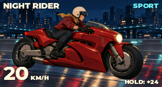

# Night Rider

按住下方旋钮，吉他的音高像摩托车加速一样往上滑。松手就落回去。

## 配套音频包

先安装音频包，再安装 App。

- Rider Engine `org.resona.demo.night-rider.engine` 0.2.1

## 两个编码器

| 页面／模式 | 上方旋转 | 上方短按 | 上方长按 | 下方旋转 | 下方短按 | 下方长按／按住 |
| --- | --- | --- | --- | --- | --- | --- |
| Night Rider | 选 CRUISE／SPORT／TURBO | 干声对比开／关 | 立即保存 | 设移调范围 +1～+24 半音 | 短踩可做短促升降音 | 按住升到设定音程，松开回落 |

## 项目详细说明

# Night Rider

An illustrated night ride where the bike's speed is the guitar's pitch. At rest it rolls at 20 km/h with no
shift; holding the big knob is a whammy that glides the pitch up to the set range (+24 semitones by default)
and the bike up to 300 km/h. The sound is the nested `dsp/` pack (**Rider Engine**).

The illustration closely follows a well-known anime motorcycle design. Treat it as an internal demo asset and
replace the art before any public release.

## Controls

| Control | Turn | Click | Long press / hold |
|---|---|---|---|
| SELECTOR (top) | style: CRUISE, SPORT, TURBO | DRY compare on/off | save now |
| CUSTOMIZE (big) | whammy range, +1 to +24 semitones | | whammy: up to the range in 1 s, held while you hold; back down in 0.6 s on release |

Range, style, MIX and LEVEL are saved 1.5 s after a change (and at once on a SELECTOR long press).

## The screen

- **km/h** is a pitch meter: 20 km/h is no shift, each semitone adds about 11.7 km/h, 300 km/h is +24.
- **Bottom right**: HOLD: +24 (the range) at rest, WHAMMY +13 (the current shift) while it moves, DRY GUITAR
  while comparing. Top right: the style, or DRY.
- **The ride**: city, highway and road scroll in parallax with motion blur picked by speed; the bike vibrates and
  pitches under acceleration, the wheels spin, the rider tucks with speed and the scarf waves. Tail-light trail,
  headlight bloom and boost streaks. Playing shakes the bike harder but never changes its speed.
- **Status line**: INSTALL RIDER ENGINE IN LAB until the pack is in the Box's library; CPU LIMIT if the OS
  bypasses the engine for its CPU budget (the App rebuilds its audio after 2 s, then 10 s, then 30 s).
- **Boot splash**: the App writes `src/splash_data.h` as the Box's boot splash when it differs; it plays from the
  next power-up (the night road, speed streaks, then the bike at 300 with WHAMMY +24).

## Controller

`controller/` holds a Web controller (the Resona Box website's look) and a Mobile one (the Creator Lab app's look). Any MIDI controller can play Night Rider too: every control is one CC on channel 1, over USB, Bluetooth or the MIDI jack. CC 119 asks the App for every value; it then reports changes, including ones made with the knobs, and the input and output meters on CC 116 and 117.

The controllers add four hold pads, a THROTTLE and an XY surface (THROTTLE across, MIX up). THROTTLE holds the whammy at any interval for as long as it is up (0 is rest), so MIX below 100 turns it into a harmony over the dry guitar. A release always glides back down on the range it went up with.

| CC | Control | Values |
|---|---|---|
| 20 | Whammy range | 0 to 127: +1 to +24 semitones |
| 21 | Style | 0 CRUISE, 1 SPORT, 2 TURBO |
| 22 | THROTTLE | 0 to 127: rest to +24 semitones (not saved) |
| 23 | DRY compare | 0 off, 1 on |
| 24 | MIX | 0 to 127: 0 to 100 % (100 default; 0 is the dry guitar) |
| 25 | LEVEL | 0 to 127: 0 to 100 (80 default, unity) |
| 26 | Speed (App to controller) | 0 to 127: 20 to 300 km/h |
| 30 | BEND (hold) | 127 press, 0 release: the big knob's whammy hold, up to the range |
| 31 | +12 (hold) | 127 press, 0 release: the whammy to +12, whatever the range |
| 32 | NITRO (hold) | 127 press, 0 release: TURBO style and the whammy to +24 |
| 33 | DRY (hold) | 127 press, 0 release: the dry guitar |

## DSP: Rider Engine

    input -> whammy (period-locked pitch shifter) -> drive -> tone -> idle throb -> air rush
          -> make-up gain -> MIX with the guitar -> LEVEL -> DC block -> soft limiter

- **Whammy** (`dsp/src/whammy.h`): one read head runs through a delay line faster than the guitar is written and
  jumps back by whole periods of the note, tracked continuously, so held notes and power chords stay smooth.
  Full chords without a clear period still warble.
- **Drive**: asymmetric soft clipping; gain grows with speed squared (most in TURBO).
- **Tone**: state-variable low-pass opening from 2.4 kHz at rest to 7 kHz at top speed, resonant in SPORT.
- **Idle throb**: faint amplitude modulation at an engine firing rate, only at rest. **Air rush**: a short flanger
  whose sweep speeds up with speed.
- A make-up gain per style and speed keeps the engine within about 1 dB of the dry guitar. At MIX 0 the guitar
  passes at unity; LEVEL scales only the wet. STYLE and WHAMMY changes glide rather than jump.

| Parameter | Range | Set by the App |
|---|---|---|
| SPEED | 0 to 100 % | the bike's speed, which follows the whammy glide |
| BOOST | 0 or 1 | 1 while the whammy is engaged (big knob hold, a pad, or THROTTLE above 0) |
| STYLE | CRUISE, SPORT, TURBO | SELECTOR turn, controller CC 21; NITRO forces TURBO |
| MIX | 0 to 100 % | 100, or controller CC 24; 0 while DRY |
| LEVEL | 0 to 100 % | 80 (unity), or controller CC 25 |
| WHAMMY | 0 to 24 semitones | CUSTOMIZE turn, controller CC 20; THROTTLE, +12 and NITRO override while held |

The App builds its own audio graph (Guitar -> Rider Engine -> Output and Capture; USB and Bluetooth to Output),
so the Box's presets are suspended while it runs. No preset slot is written.

## Build

    resona-lab pack build dsp
    resona-lab pack install dsp/build/*.rpk     # store the pack in the Box's library first
    resona-lab app build .
    resona-lab app install .
    python3 tools/encode_ride.py                # regenerate src/ride_art.h (numpy, scipy, Pillow)

`tools/encode_ride.py` cuts `assets/original.png` into the ride layers using `assets/background.png`,
`assets/bike-underlay.png` and `assets/rig-data.json`. `src/splash_data.h` comes from `tools/make_splash.py`
with `tools/splash_frames.cpp`. Normal builds need only the generated headers.

The encoder-emulating CCs on MIDI channel 16, the bench stats SysEx and the screen capture
(`src/demo_capture.h`) are compiled in only with `-DRESONA_DEMO_BENCH`.

HUD type: Montserrat Bold, SIL Open Font License, see `assets/Montserrat-OFL.txt`.
